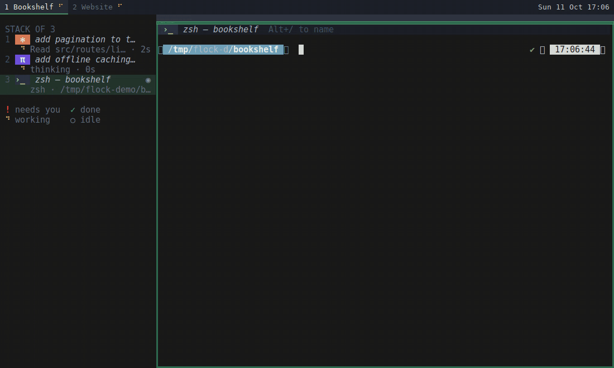

# flock

**Keep an eye on your CLI coding agents without leaving the keyboard — or i3.**

flock adds an agent-aware sidebar, labels, per-session notes and notifications to an ordinary
[i3](https://i3wm.org/) desktop. Your windows stay normal i3 windows, stacked or side by side however
you like; flock just watches Claude Code and Pi and tells you which one is working, which one is done
and which one needs you.



> flock is a small, local-only take inspired by [herdr](https://herdr.dev/). herdr is a full agent
> workspace; flock is deliberately just the missing pieces for people who already live in i3 — no
> server, no new terminal, no mouse required.

## Why

Running several agents in stacked terminals works well in i3 until you lose track of them: which one
finished, which one is stuck on a permission prompt, what was that one for again? Keybindings handled by
the terminal tend to be swallowed by the agent that has focus. flock solves this from the outside:
every action is an **i3 binding**, so it works whichever agent has the keyboard.

## What you get

- **Sidebar** — the focused workspace's windows, grouped the way i3 lays them out (columns, stacks,
  tabs), with app icons, slot numbers, agent state and how long it has been in it. `Super+b` condenses it
  to an icon rail. Its `≡ menu` (click it) holds the text size, condense, a notifications switch and
  the legend.
- **Agent state** — working (amber spinner), needs you (red `!`), done but not yet seen (green `✓`) or
  idle (`○`), reported by the agents themselves through Claude Code hooks and a Pi extension.
- **Notifications** — a desktop notification when an agent needs you or finishes out of sight; its
  action jumps to the agent. Waiting agents also get i3's urgency colour.
- **Labels** — `Alt+/` names a terminal or an agent after its task. Until then, an agent is called by
  the prompt you gave it.
- **Notes per agent session** — `Alt+.` drops a small checklist down from the agent's header. Notes and
  labels are saved against the agent's session id, so `claude --resume` (in any terminal) brings them
  back.
- **A header in every flock terminal** — label, program, directory, state and a `notes [done/total]`
  strip, drawn by a private, keyless tmux.
- **Helpers for stacks** — `Alt+Shift+1…9` moves the focused window to that slot; `Super+u` jumps to the
  next agent that needs you.
- **Status bar feed** — `flock bar` prints each workspace's name and one status logo for polybar.

## Requirements

- Linux with X11 and **i3 ≥ 4.22**
- **tmux ≥ 3.2**
- Go ≥ 1.24 to build
- Optional: a notification daemon (dunst, …), polybar, Claude Code, Pi

## Install

```sh
GOBIN=~/.local/bin go install github.com/murrayb52/flock/cmd/flock@latest
flock version           # must say "flock …", see below
flock install claude    # adds hooks to ~/.claude/settings.json (keeps yours; backup saved)
flock install pi        # writes ~/.pi/agent/extensions/flock.ts
```

Most Linux systems already have a different `flock` (the file-locking tool from util-linux, in
`/usr/bin`). Install this one into a directory that comes **before** `/usr/bin` in your `PATH` — and in
i3's, which is the `PATH` your session started with. `~/.local/bin` usually is; `~/go/bin` usually
is not. If `flock version` says `bad file descriptor`, that is util-linux's `flock`: fix the `PATH` order.

Then wire it into i3. Copy [`examples/i3.conf`](examples/i3.conf) to `~/.config/i3/flock.conf`, adjust
the bindings, and include it from your config:

```i3
include ~/.config/i3/flock.conf
```

The important lines are:

```i3
exec_always --no-startup-id flock daemon            # the daemon also opens the sidebar
bindsym $mod+Return exec flock term                 # opens your default terminal as a flock terminal
for_window [class="flock-sidebar"] floating enable, sticky enable, border none
no_focus [class="flock-sidebar"]
font pango:monospace 1                              # slim stack/tab title bars
```

`flock term` started from a key binding opens your default terminal (`$TERMINAL`, else
`x-terminal-emulator`) running itself; set `terminal` in the config to choose another. Run inside an
existing terminal, it turns that one into a flock terminal. For the bar, see
[`examples/polybar.ini`](examples/polybar.ini). Remove the integrations with
`flock uninstall claude|pi|all`.

## Keys (from the example config)

| Keys | Action |
| --- | --- |
| `Super+b` | condense / expand the sidebar |
| `Alt+/` | label the focused terminal or agent |
| `Alt+.` | open / close the focused agent's notes |
| `Super+u` | focus the next agent that needs you |
| `Super+n` | `dunstctl action`: jump to the agent in the latest notification |
| `Alt+Shift+1…9` | move the focused window to that position in its stack |

In the notes drawer: `Tab`/`↓` next, `Shift+Tab`/`↑` previous, `Space` tick, type or `Enter` to edit,
`Del` remove, `Esc` close.

## How it works

```
 i3 IPC ──────┐                         ┌──▶ sidebar (TUI in a terminal window)
 tmux server ─┼──▶  flock daemon  ──────┼──▶ flock bar (polybar)
 agent hooks ─┘   state · labels · notes└──▶ tmux headers · notifications · urgency
```

- `flock term` starts each terminal as a session on a **private tmux server** (`tmux -L flock`) with no
  prefix key and no bindings, so tmux never takes a keystroke. Its top status lines are the header and
  notes strip; `display-popup` hosts the notes editor.
- Claude Code hooks (`flock hook claude …`) and the Pi extension report state over a Unix socket in
  `$XDG_RUNTIME_DIR/flock/`. They never print, never fail and time out quickly, so they cannot slow an
  agent down.
- Labels and notes live in `~/.local/share/flock/sessions/`, one small JSON file per agent session.
- The sidebar is a terminal window (`class flock-sidebar`), floating, sticky and never focused, placed in
  an i3 `gaps left` margin that flock keeps equal to its width.

### Other agents

Anything that can run a command can report its state from inside a flock terminal:

```sh
flock event my-agent prompt session=$ID prompt="fix the tests"
flock event my-agent input  session=$ID detail="Allow rm -rf build?"
flock event my-agent stop   session=$ID detail="All green."
```

## Configuration

Optional, in `~/.config/flock/config.toml`:

```toml
terminal = "kitty"       # opened by `flock term` from a key binding; default: your default terminal
                         # (or a template such as "my-term --run {cmd}")
sidebar_terminal = "alacritty"  # must set its window class: alacritty, kitty, ghostty, wezterm, foot,
                         # xterm, or a template such as "st -c {class} -f mono:size={font} -e {cmd}"
sidebar_width = 280      # pixels
sidebar_font_size = 11   # points; the sidebar's − + buttons override it (saved in ~/.local/share/flock)
rail_width = 64
notifications = true
label_key = "Alt+/"      # key names shown in terminal headers — match your bindings
notes_key = "Alt+."
```

Extra tmux settings for flock terminals go in `~/.config/flock/tmux.conf`.

## Good to know

- The 1pt title font applies to **all** i3 title bars, not just stacks — that is what makes stacks slim.
- Inside flock terminals, scrollback is tmux's (mouse wheel works); select text with `Shift`+drag.
- Pi has no permission prompts: flock treats a Pi dialog, or a turn that ends with a question, as
  "needs you".
- The sidebar follows the focused output; the gap applies to every workspace.

## Development

```sh
go test ./...
demo/nested.sh start    # flock in a nested i3 (Xephyr) with its own dunst, polybar and tmux
demo/record.sh          # re-record docs/demo.gif with a scripted fake agent (no API keys needed)
```

The design notes are in [`docs/superpowers/specs`](docs/superpowers/specs), and
[`demo/flock-mockup.html`](demo/flock-mockup.html) is the interactive mockup flock was designed from.

## Licence

[MIT](LICENSE) © 2026 Murray Buchanan
